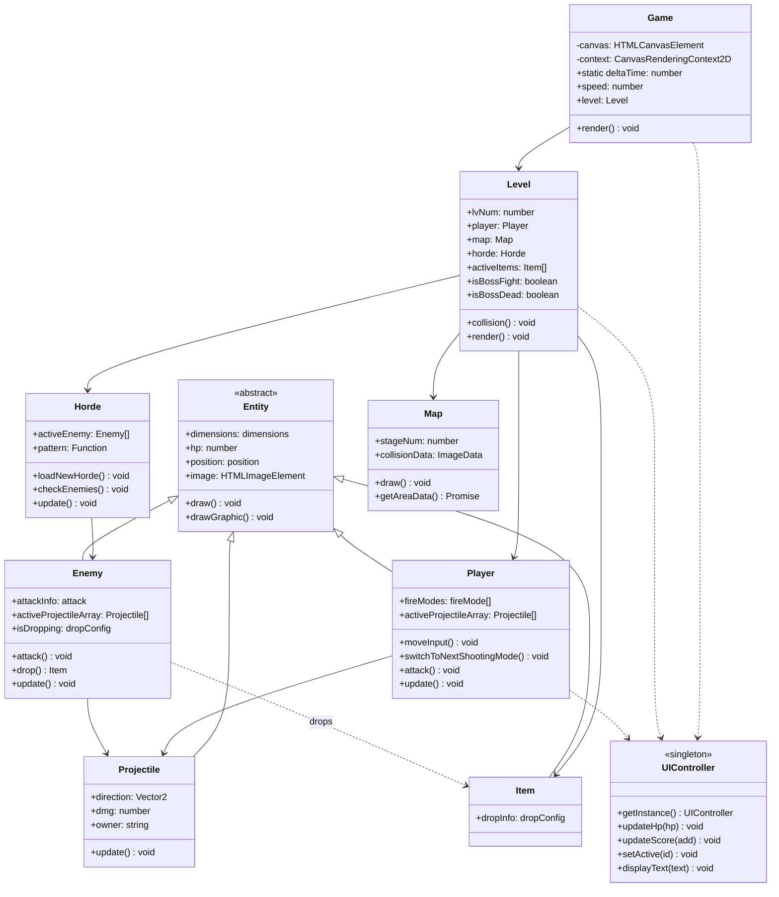
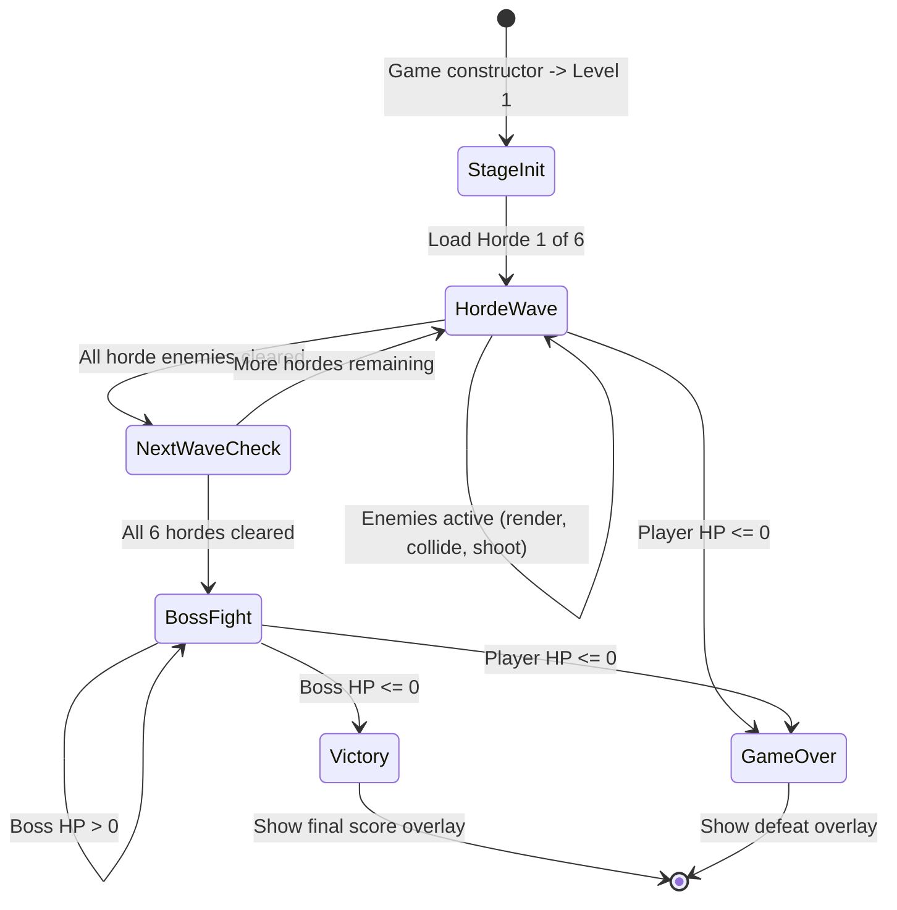

# Zybex — Atari 8-bit Remake

[](https://dudek03.github.io/Zybex/)
[](https://www.typescriptlang.org/)
[](https://vitejs.dev/)
[](https://developer.mozilla.org/en-US/docs/Web/API/Canvas_API)

A browser-based horizontal shoot-'em-up inspired by the classic 1988 Atari 8-bit game **Zybex**, built from scratch with **TypeScript**, **Vite**, and the **HTML5 2D Canvas API**. Battle through mathematically choreographed enemy waves, dodge pixel-accurate scrolling terrain, collect weapon upgrades, and defeat the stage boss.

> **Play in your browser:** [https://dudek03.github.io/Zybex/](https://dudek03.github.io/Zybex/)

---

## Overview & Features

- **Retro Pixel-Art Presentation**: Renders on a crisp `1816 × 532` HTML5 Canvas (`imageSmoothingEnabled = false`) styled with the custom `AtariClassic.ttf` typeface and retro arcade HUD bars (HP counter, weapon selector, player tag, score, and stage indicator).
- **Delta-Time Game Loop**: Frame-rate-independent movement, scrolling, and projectile physics driven by `requestAnimationFrame` and `performance.now()`.
- **Pixel-Based Terrain Collision**: Loads a dedicated offscreen collision mask (`public/level1/collision.png`) alongside the scrolling background (`bgMap.png`) and samples RGBA pixel data beneath the player hitbox to detect terrain impacts.
- **Multi-Mode Weapon Arsenal & Upgrades**: Four weapon slots displayed in the top HUD with locked/unlocked visual states; collecting duplicate weapon drops upgrades the active fire mode's damage multiplier (`power`).
- **Choreographed Enemy Hordes & Boss Fight**: Six sequential enemy formations following mathematical flight paths (sine waves, absolute sine bounces, diagonal sweeps, and harmonic curves), culminating in a multi-shot boss encounter.
- **Automated Deployment**: Built and deployed to GitHub Pages via GitHub Actions (`.github/workflows/deploy.yaml`).

---

## Gameplay Mechanics

### Controls

| Key | Action |
| :--- | :--- |
| `W` / `A` / `S` / `D` | Move player up, left, down, right |
| `Space` | Fire active weapon (press or hold) |
| `Ctrl` (`Control`) | Cycle to the next unlocked weapon mode |

### Weapons & Fire Modes

| Mode | Starting State | Cooldown | Pattern & Base Damage |
| :---: | :--- | :---: | :--- |
| **Weapon 1** | Unlocked (Active) | `100 ms` | Rapid single forward shot (`1 dmg`) — upgradeable via drop |
| **Weapon 2** | Locked (Horde 1 drop) | `1000 ms` | Heavy forward beam (`10 dmg`) + vertical up & down shots (`1 dmg` each) |
| **Weapon 3** | Unlocked | `500 ms` | Tall forward energy wave (`5 dmg`) + upper & lower diagonal shots (`2 dmg` each) |
| **Weapon 4** | Locked (Reserved slot) | `1000 ms` | Single forward shot (`1 dmg`) |

### Enemies, Drops & Boss Progression

- **Health & Respawn**: You start with **3 HP**. Colliding with terrain, enemy ships, or enemy projectiles deducts `1 HP` and resets your ship to the left-center safe point (`x = 10, y = canvas.height / 2`).
- **Scoring**: Defeating an enemy awards **+200 points**.
- **Item Drops**: Specific enemies drop **Health Pickups** (`+1 HP`) or **Weapon Pickups** (unlocking a locked fire mode or increasing its `power` multiplier if already owned).
- **Stage 1 Waves**: Clearing all 6 enemy hordes automatically triggers the **Boss Fight** — a `20 HP` boss following a harmonic flight trajectory (`sin(3x/200) * cos(2x/200)`) while unleashing a 7-projectile spread volley every `1000 ms`.

---

## Architecture & Game Loop

### Engine Class Structure



### Stage Progression Flow



---

## Tech Stack

- **Language**: TypeScript `4.6` (strict mode enabled in `tsconfig.json`)
- **Bundler / Dev Server**: Vite `3.2`
- **Rendering**: HTML5 Canvas 2D Context (zero external game engine dependencies)
- **Styling**: Custom CSS3 + `AtariClassic.ttf` pixel font
- **CI/CD**: GitHub Actions (`deploy.yaml` -> GitHub Pages)

---

## Project Structure

```text
Zybex/
├── .github/workflows/
│   └── deploy.yaml          # Automated Vite build & GitHub Pages deployment
├── public/
│   ├── AtariClassic.ttf     # Retro Atari arcade font
│   ├── level1/
│   │   ├── bgMap.png        # Scrolling stage 1 background artwork
│   │   └── collision.png    # Pixel-accurate terrain collision mask
│   ├── weapons/             # HUD & drop icons (weapon1.PNG – weapon4.PNG)
│   └── *.PNG                # Player, enemy, boss, projectile & HP sprites
├── src/
│   ├── Game.ts              # Application entry point & requestAnimationFrame loop
│   ├── Level.ts             # Stage 1 horde definitions, boss config & collision system
│   ├── Entity.ts            # Abstract base class for all drawable entities
│   ├── Player.ts            # Input handling, movement & 4 weapon fire modes
│   ├── Enemy.ts             # Enemy AI firing cooldowns & item drops
│   ├── Horde.ts             # Wave spawning & mathematical flight patterns
│   ├── Projectile.ts        # Directional projectile movement & rendering
│   ├── Item.ts              # Collectible HP & weapon upgrade entities
│   ├── Map.ts               # Background scrolling & offscreen collision pixel sampling
│   ├── UIController.ts      # Singleton DOM HUD controller
│   ├── interfaces.ts        # Shared TypeScript interfaces
│   ├── utilities.ts         # Image loaders & AABB rectangle collision helper
│   └── style.css            # Arcade layout & weapon HUD overlays
├── index.html               # Game viewport & HUD markup
├── vite.config.js           # Build base-path configuration via BASE_URL
├── tsconfig.json            # Strict TypeScript compiler configuration
└── package.json             # Project scripts & devDependencies
```

---

## Getting Started

### Prerequisites

- **Node.js** (v16+ recommended) and **npm**

### Installation

```bash
git clone https://github.com/Dudek03/Zybex.git
cd Zybex
npm install
```

### Running Locally

Start the Vite development server:

```bash
npm run dev
```

Open the local URL displayed in your terminal (typically `http://localhost:5173`).

### Building for Production

Type-check with `tsc` and generate a production bundle in `dist/`:

```bash
npm run build
```

Preview the production build locally:

```bash
npm run preview
```

> **Note:** When building for a subpath (such as GitHub Pages), set the `BASE_URL` environment variable (e.g., `BASE_URL=/Zybex/`), which `vite.config.js` reads during `vite build`.
